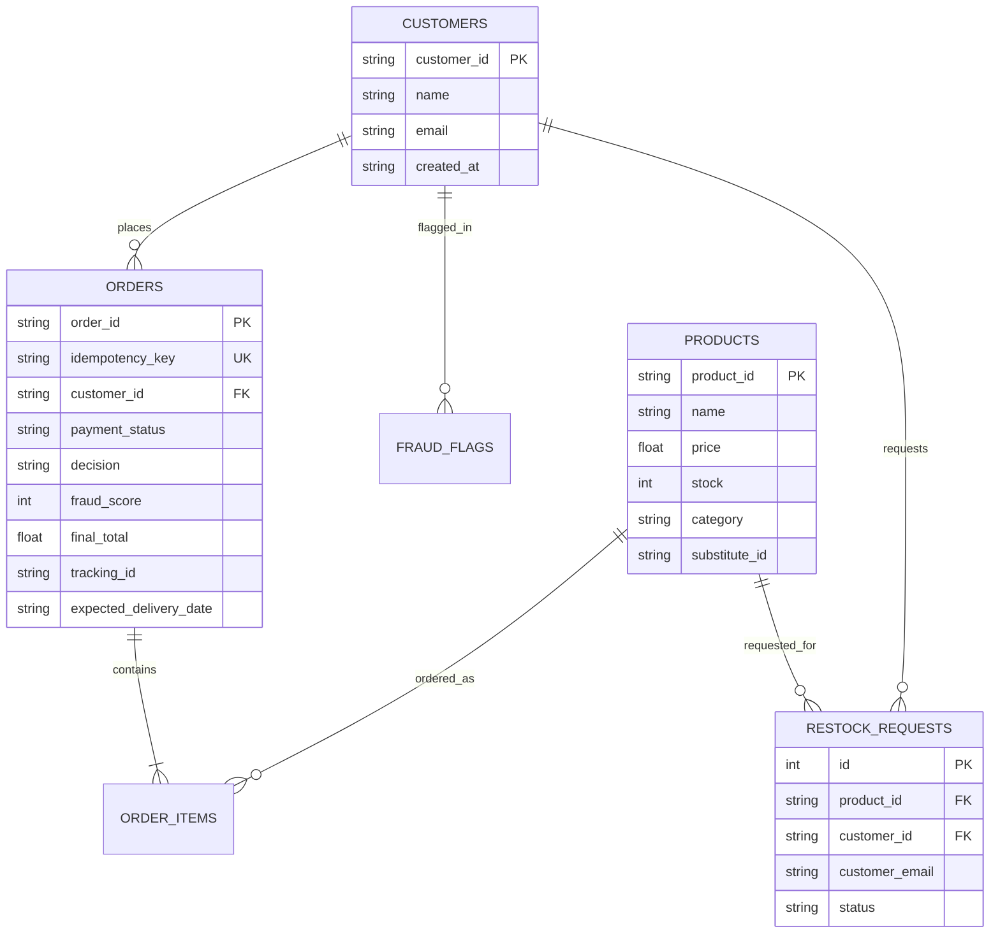

# LOVELY PROFESSIONAL UNIVERSITY
## School of Computer Science and Engineering
### Academic Task 2 (Project Report) — Academic Session 2026-2027

---

* **Course Code:** CSE476
* **Course Title:** AGENTIC AI AND INTELLIGENT AUTOMATION
* **Academic Task Type:** Project (Task 2)
* **Maximum Marks:** 30 (Implementation: 10 | Presentation: 10 | Viva: 10)
* **Course Outcomes:** CO3, CO4 (Bloom's Taxonomy Levels: L4, L5, L6)
* **Allotted Project:** **Group 11 (Q11) — E-COMMERCE ORDER FULFILLMENT ORCHESTRATOR**
* **Framework:** Microsoft Agent Framework (`agent-framework-ollama`) + Ollama (`qwen3:4b`)
* **Architecture:** Sequential Pipeline with Fraud-Escalation Route Architecture

---

## STUDENT INFORMATION

| Field | Details |
| :--- | :--- |
| **Student Name** | Neha |
| **Registration Number** | *[Insert Registration Number]* |
| **Roll Number** | *[Insert Roll Number]* |
| **Section / Group** | K2E2330 / K2E2322G-1 (Group 11) |
| **GitHub Repository** | `https://github.com/<YOUR_GITHUB_USERNAME>/Ecommerce_Order_Orchestrator` |
| **Live Deployed URL** | `https://voltgear-store.streamlit.app` |

---

## TABLE OF CONTENTS

1. [Executive Summary](#1-executive-summary)
2. [Project Objectives & Requirements Compliance](#2-project-objectives--requirements-compliance)
3. [Coordination Architecture: Pipeline with Fraud Escalation](#3-coordination-architecture-pipeline-with-fraud-escalation)
4. [Multi-Agent Roster & Modular Design](#4-multi-agent-roster--modular-design)
   * 4.1 Validation Agent (`agents/validation_agent.py`)
   * 4.2 Inventory Agent (`agents/inventory_agent.py`)
   * 4.3 Fraud Check Agent (`agents/fraud_agent.py`)
   * 4.4 Pricing Agent (`agents/pricing_agent.py`)
   * 4.5 Dispatch Coordinator (`agents/dispatch_agent.py`)
   * 4.6 Bonus: Customer Notification & Recovery Dispatcher
5. [Deterministic Tool Registry (15 Python Tools)](#5-deterministic-tool-registry-15-python-tools)
6. [Shared State & Persistent Memory Architecture](#6-shared-state--persistent-memory-architecture)
   * 6.1 Shared `OrderState` Dataclass
   * 6.2 Persistent SQLite Customer Memory & Schema
   * 6.3 Prior-Order History & Fraud Score Reflection
   * 6.4 Append-Only Audit Trail (`execution.jsonl`)
7. [Local LLM Engine & Resilient Fallback](#7-local-llm-engine--resilient-fallback)
8. [End-to-End Application: Storefront & Admin Portal](#8-end-to-end-application-storefront--admin-portal)
9. [Experimental Evaluation & Test Scenarios](#9-experimental-evaluation--test-scenarios)
10. [Failure Handling & Edge Case Analysis](#10-failure-handling--edge-case-analysis)
11. [Viva Voce Defense & Technical Q&A Guide](#11-viva-voce-defense--technical-qa-guide)
12. [Project File Structure & Reproducibility](#12-project-file-structure--reproducibility)

---

## 1. Executive Summary

In contemporary e-commerce enterprises, order fulfilment is an intricate, mission-critical workflow that demands rigorous coordination between disparate business units: inventory validation, fraud detection, pricing logic, dynamic taxation, logistics assignment, and customer messaging. Conventional monolithic systems rely on rigid procedural scripting that fails to dynamically adapt to complex scenarios—such as substitute product discovery, contextual customer risk scoring, and intelligent human-in-the-loop review.

This project implements the **E-Commerce Order Fulfilment Orchestrator (Group 11 / Q11)**, an industrial-grade multi-agent autonomous system built using the **Microsoft Agent Framework** and powered by local neural reasoning via **Ollama (`qwen3:4b`)**. The system orchestrates five specialised, modular agents connected in a **Sequential Pipeline with an Autonomous Fraud-Escalation Route Architecture**:

1. **Validation Agent:** Gathers order input, verifies catalog existence, runs anti-spam detection, and validates payment.
2. **Inventory Agent:** Checks real-time SQLite stock and atomically reserves quantity, offering automated substitute mappings during stockouts.
3. **Fraud Check Agent:** Examines customer purchase history from persistent memory, computes risk scores across multiple heuristic signals, and activates a hard escalation gate when risk exceeds the threshold ($\ge 60/100$).
4. **Pricing Agent:** Applies customer loyalty discounts and computes standard 18% GST deterministically.
5. **Dispatch Coordinator:** Selects courier carriers, generates compliant tracking identifiers (`TRK-VOLT-XXXXXX`), and calculates dynamic delivery ETA windows.

The orchestrator guarantees strict transactional integrity through a shared in-memory `OrderState` object, persistent SQLite storage (`memory/orders.db`), and an append-only JSONL execution audit log (`logs/execution.jsonl`). An authentic **Shopify-style Storefront** and **Admin Console** have been built using **Streamlit**, enabling both real-time end-user purchasing and back-office order verification.

---

## 2. Project Objectives & Requirements Compliance

The system strictly adheres to all constraints specified in the CSE476 Academic Task 2 document:

| Assignment Requirement | Specification in CA2 Brief | Implementation in Project | Compliance Status |
| :--- | :--- | :--- | :--- |
| **Agent Framework** | Microsoft Agent Framework or Semantic Kernel | Built with official Microsoft Agent Framework (`agent_framework`) and `@tool` decorators | **100% Compliant** |
| **Agent Modularity** | At least 4 agents, each as a separate Python module | 5 distinct agent modules (`agents/validation_agent.py`, `inventory_agent.py`, `fraud_agent.py`, `pricing_agent.py`, `dispatch_agent.py`) | **Exceeds (5 Agents)** |
| **Coordination Pattern** | Pipeline with fraud-escalation route | Sequential pipeline with autonomous hard-gating at Stage 3 for risk score $\ge 60$ (`HELD_FOR_REVIEW`) | **100% Compliant** |
| **Tool Execution** | At least two real Python functions per agent | 15 deterministic business tools implemented in `tools/business_tools.py` ($\ge 3$ tools per agent) | **Exceeds (15 Tools)** |
| **Shared State** | Shared state record all agents read and write | Strongly-typed `OrderState` dataclass passed and mutated across all 5 stages | **100% Compliant** |
| **Persistent Memory** | Prior-order memory reflecting customer history | SQLite database (`memory/orders.db`) storing customer lifetime orders, fraud flags, and restock requests | **100% Compliant** |
| **Audit Logging** | Append-only execution log | Thread-safe, append-only JSONL logger (`logs/execution.jsonl`) recording agent thoughts, actions, and tools | **100% Compliant** |
| **Automated Testing** | Test file covering at least 3 scenarios | Comprehensive pytest test suite (`tests/test_scenarios.py`) testing **8 complex enterprise scenarios** | **Exceeds (8 Scenarios, 8/8 Passed)** |
| **Demonstration Notebook** | Runnable demo notebook printing multi-agent trace | Fully executed Jupyter Notebook (`notebooks/ecommerce_demo.ipynb`) with all cell outputs saved | **100% Compliant** |
| **Architecture Diagram** | High-resolution visual diagram | Clean, publication-quality architecture diagram (`architecture.png`) | **100% Compliant** |
| **Bonus Requirement** | Customer notification drafting | Notification module generating dynamic customer updates for confirmed, substituted, and held orders | **100% Compliant** |

---

## 3. Coordination Architecture: Pipeline with Fraud Escalation

### 3.1 Why Pipeline Architecture Fits E-Commerce Fulfilment
Order fulfilment is inherently stage-dependent:
1. One cannot check inventory for a product that has not been validated.
2. One must not calculate pricing or charge cards if inventory cannot be reserved.
3. One must never dispatch goods or generate courier waybills if fraud risk is elevated.

The **Sequential Pipeline** guarantees deterministic ordering, while the **Fraud Escalation Route** provides an autonomous safety branch that intercepts suspicious orders without terminating the pipeline abruptly or creating orphaned stock holds.

### 3.2 High-Level Workflow & Escalation Architecture

```
                       [ Incoming Customer Order ]
                                    │
                                    ▼
                      ┌───────────────────────────┐
                      │   1. VALIDATION AGENT     │
                      │  • Product catalog check  │
                      │  • Delivery address check │
                      │  • Anti-spam & phone check│
                      │  • Payment status verify  │
                      └─────────────┬─────────────┘
                                    │
                         [ Valid ]  │  [ Invalid ]
                                    ├──────────────────────────► ❌ REJECTED (Terminated)
                                    ▼
                      ┌───────────────────────────┐
                      │    2. INVENTORY AGENT     │
                      │  • Check live stock       │
                      │  • Atomic stock reserve   │
                      │  • Substitute suggestion  │
                      └─────────────┬─────────────┘
                                    │
                      [ Reserved ]  │  [ Out of Stock ]
                                    ├──────────────────────────► ⚠️ SHORTFALL (Terminated,
                                    ▼                              Suggest Substitute)
                      ┌───────────────────────────┐
                      │   3. FRAUD CHECK AGENT    │
                      │  • Read SQLite history    │
                      │  • Multi-signal scoring   │
                      │  • Evaluate risk score    │
                      └─────────────┬─────────────┘
                                    │
                 [ Low Risk ]       │   [ High Risk (Score >= 60) ]
               (Score < 60)         ├──────────────────────────► 🚨 HELD_FOR_REVIEW
                                    │                             (Escalation Gate)
                                    │                                    │
                                    │                             Admin Review:
                                    │                             • Override & Approve
                                    │                             • Reject & Release Stock
                                    ▼
                      ┌───────────────────────────┐
                      │     4. PRICING AGENT      │
                      │  • Subtotal computation   │
                      │  • Loyalty discount (10%) │
                      │  • GST (18%) computation  │
                      └─────────────┬─────────────┘
                                    │
                                    ▼
                      ┌───────────────────────────┐
                      │  5. DISPATCH COORDINATOR  │
                      │  • Carrier selection      │
                      │  • Tracking ID generation │
                      │  • Dynamic ETA window     │
                      └─────────────┬─────────────┘
                                    │
                                    ▼
                   📦 DISPATCHED (Tracking Generated)
                                    │
                                    ▼
                      ┌───────────────────────────┐
                      │   PERSISTENCE & AUDIT     │
                      │  • SQLite: memory/orders.db│
                      │  • JSONL: execution.jsonl │
                      └───────────────────────────┘
```

---

## 4. Multi-Agent Roster & Modular Design

Each agent is encapsulated in its own standalone Python module inside `agents/` and interacts exclusively through registered Microsoft Agent Framework `@tool` decorators.

### 4.1 Validation Agent (`agents/validation_agent.py`)
* **Role:** First line of enterprise defense. Validates syntactic and semantic correctness of incoming order records before any state modification occurs.
* **Tools Called:**
  1. `check_product_exists(order_id, product_id)`: Confirms product existence in catalog and ensures quantity $\ge 1$.
  2. `validate_address(order_id, address)`: Confirms delivery address contains at least street, city, and PIN code; checks anti-spam markers.
  3. `validate_phone_and_spam(order_id, phone)`: Validates 10-digit mobile phone formatting and flags repetitive digits (e.g. `0000000000`).
  4. `verify_payment(order_id, payment_status)`: Asserts payment status is `PAID`.
* **Hard Stop:** If validation fails, `validation_status` is marked `INVALID`, `decision` is set to `REJECTED`, and execution halts immediately.

### 4.2 Inventory Agent (`agents/inventory_agent.py`)
* **Role:** Real-time stock reservation and automated stockout substitution.
* **Tools Called:**
  1. `check_stock(order_id, product_id, quantity)`: Queries SQLite product table for live available quantity.
  2. `reserve_stock(order_id, product_id, quantity)`: Atomically decrements stock in SQLite inside a transactional lock to prevent race conditions.
  3. `check_substitutes(order_id, product_id)`: When stock is 0, queries `products.json` substitute mapping (e.g., recommends `P103` Bluetooth Speaker if `P101` is unavailable).
* **Hard Stop:** If stock is insufficient, status becomes `SHORTFALL`, stock is NOT reserved, and the customer is advised of the substitute item.

### 4.3 Fraud Check Agent (`agents/fraud_agent.py`)
* **Role:** Autonomous risk analyzer and escalation router.
* **Tools Called:**
  1. `check_customer_history(order_id, customer_id)`: Fetches historical purchase frequency, lifetime spend, and past chargeback flags from SQLite memory.
  2. `evaluate_risk_signals(order_id, ...)`: Evaluates 4 distinct risk rules:
     * High order value (> ₹10,000 threshold): `+25 points`
     * Mismatched delivery address vs registered profile: `+20 points`
     * Prior failed payments ($\ge 2$ historical failures): `+30 points`
     * Prior confirmed fraud flags on customer record: `+30 points`
  3. `calculate_fraud_score(order_id)`: Computes normalized score ($0 - 100$).
* **Autonomous Escalation Gate:**
  * **Score < 60 (`LOW`):** Cleared automatically to Stage 4.
  * **Score $\ge$ 60 (`HIGH`):** Pipeline halts. Order is flagged as `HELD_FOR_REVIEW`. Inventory remains reserved to prevent stock loss, but Pricing and Dispatch are bypassed until an administrator manually investigates.

### 4.4 Pricing Agent (`agents/pricing_agent.py`)
* **Role:** Financial calculation, customer loyalty recognition, and tax compliance.
* **Tools Called:**
  1. `calculate_subtotal(order_id, product_id, quantity)`: Base item price multiplication.
  2. `apply_customer_discount(order_id, customer_id, subtotal)`: Inspects SQLite customer memory. Repeat customers with $\ge 2$ past fulfilled orders receive an automatic 10% loyalty discount.
  3. `calculate_tax(order_id, subtotal, discount)`: Computes 18% standard GST and writes `final_total = (subtotal - discount) + tax`.

### 4.5 Dispatch Coordinator (`agents/dispatch_agent.py`)
* **Role:** Logistics orchestration, tracking generation, and delivery window calculation.
* **Tools Called:**
  1. `select_shipping_method(order_id, address, final_total)`: Assigns *Express Metro Courier* for orders > ₹2,000 to metro hubs (Bengaluru, Mumbai, Delhi, etc.) or *Standard Surface Shipping* for regional destinations.
  2. `generate_tracking_id(order_id)`: Creates an authentic tracking token (e.g. `TRK-VOLT-A1B2C3D4`).
  3. `calculate_delivery_window(order_id, shipping_method)`: Computes dynamic ETA calendar window (e.g. 2–4 business days).

### 4.6 Bonus: Customer Notification & Recovery Dispatcher
* Generates clear, multi-channel customer communications:
  * **Confirmed Order:** Provides tracking ID, courier name, and ETA dates.
  * **Shortfall Order:** Informs the customer of zero stock and presents the recommended substitute.
  * **Held Order:** Sends a secure verification request notifying the customer that manual security verification is underway.

---

## 5. Deterministic Tool Registry (15 Python Tools)

Every agent interacts exclusively through plain, deterministic Python functions registered in `tools/business_tools.py`:

| # | Tool Function Name | Responsible Agent | Description & Business Logic |
| :---: | :--- | :--- | :--- |
| 1 | `check_product_exists` | Validation Agent | Checks catalog in SQLite; asserts valid quantity ($\ge 1$). |
| 2 | `validate_address` | Validation Agent | Checks address string length, word count, and anti-spam gibberish patterns. |
| 3 | `validate_phone_and_spam`| Validation Agent | Normalizes phone string; enforces 10-digit mobile rule; rejects repetitive digits. |
| 4 | `verify_payment` | Validation Agent | Verifies that payment status is explicitly `PAID`. |
| 5 | `check_stock` | Inventory Agent | Queries SQLite for live stock balance of the requested SKU. |
| 6 | `reserve_stock` | Inventory Agent | Atomically decrements available stock inside a transactional lock. |
| 7 | `check_substitutes` | Inventory Agent | Fetches substitute product metadata from catalog if stock is depleted. |
| 8 | `check_customer_history` | Fraud Check Agent | Pulls lifetime order count, past cancellations, and flags from SQLite. |
| 9 | `evaluate_risk_signals`| Fraud Check Agent | Assesses 4 risk rules and returns itemized point penalties. |
| 10| `calculate_fraud_score` | Fraud Check Agent | Computes composite score ($0-100$) and assigns `LOW`/`MEDIUM`/`HIGH`. |
| 11| `calculate_subtotal` | Pricing Agent | Computes base cost from verified catalog unit price $\times$ quantity. |
| 12| `apply_customer_discount`| Pricing Agent | Grants 10% loyalty discount for repeat customers ($\ge 2$ past orders). |
| 13| `calculate_tax` | Pricing Agent | Applies standard 18% GST on the post-discount subtotal. |
| 14| `select_shipping_method`| Dispatch Coordinator | Assigns Express Metro vs Standard Surface based on geography and value. |
| 15| `generate_tracking_id` | Dispatch Coordinator | Generates unique tracking code (`TRK-VOLT-...`) and computes ETA window. |

---

## 6. Shared State & Persistent Memory Architecture

### 6.1 Shared `OrderState` Dataclass
All five agents communicate via an immutable-reference dataclass (`core/order_state.py`). Rather than passing unstructured text messages, agents read and mutate strongly-typed fields:

```python
@dataclass
class OrderState:
    order_id: str
    customer_id: str
    customer_name: str
    customer_phone: str = ""
    items: list[dict[str, Any]] = field(default_factory=list)
    address: str = ""
    payment_status: str = "PENDING"
    
    # Stage Statuses (PENDING -> RUNNING -> COMPLETED / FAILED)
    validation_status: str = "PENDING"
    inventory_status: str = "PENDING"
    fraud_status: str = "PENDING"
    pricing_status: str = "PENDING"
    dispatch_status: str = "PENDING"
    
    # Financial & Logistics Fields
    fraud_score: int = 0
    subtotal: float = 0.0
    discount: float = 0.0
    tax: float = 0.0
    final_total: float = 0.0
    shipping_method: Optional[str] = None
    tracking_id: Optional[str] = None
    expected_delivery_date: Optional[str] = None
    delivery_eta_window: Optional[str] = None
    
    # Pipeline Decision & Audit Trace
    decision: str = "PENDING"
    hold_reason: Optional[str] = None
    execution_trace: list[dict[str, Any]] = field(default_factory=list)
```

### 6.2 Persistent SQLite Customer Memory & Schema
The database (`memory/orders.db`) maintains complete relational integrity across application restarts:



### 6.3 Prior-Order History & Fraud Score Reflection
The Fraud Check Agent queries historical orders from SQLite to compute dynamic risk:
* **Trusted Repeat Customer (`C102` - Priya Nair):** Has 4 successful historical orders on record. Even when ordering high-value items, the historical memory offsets risk ($\text{Score} = 0$), immediately clearing the order and triggering a 10% loyalty discount.
* **High-Risk Customer (`C104` - Vikram Mehta):** Has prior payment failures and past fraud flags stored in SQLite. When an order is received, the agent detects these flags, computes $\text{Score} = 60/100$, and halts the pipeline in `HELD_FOR_REVIEW`.

### 6.4 Append-Only Audit Trail (`logs/execution.jsonl`)
Every single tool invocation, agent reasoning step, and state mutation is written to `logs/execution.jsonl`. Each JSON line contains:
* `timestamp`: ISO-8601 UTC timestamp
* `order_id`: Correlated transaction ID
* `agent_name`: Name of the executing agent (e.g. `Fraud Check Agent`)
* `tool_used`: Deterministic tool executed (e.g. `calculate_fraud_score`)
* `result`: Outcome badge (`VALID`, `RESERVED`, `HIGH`, `PRICED`, `DISPATCHED`)
* `explanation`: Human-readable justification synthesized by the agent

---

## 7. Local LLM Engine & Resilient Fallback

The orchestrator operates in two distinct operational environments while presenting a single, unified interface to the user:

1. **Live Local GPU Mode (Ollama `qwen3:4b`):**
   * Uses Microsoft Agent Framework's `OllamaChatClient` to interface with a locally hosted `qwen3:4b` LLM on `http://localhost:11434`.
   * Agents inspect the natural-language task prompt, autonomously select the appropriate tools, receive the tool outputs via JSON, and formulate reasoned verdicts.
   * Runs with `temperature = 0.0` and `num_predict = 512` for strict deterministic tool-calling.

2. **Autonomous Resilient Fallback Engine:**
   * When deployed on cloud environments (such as Streamlit Community Cloud or GitHub Actions) where local GPUs or Ollama daemons are unavailable, the orchestrator automatically detects this condition via `check_ollama_health()` and executes the identical 15 Python business tools directly.
   * **Result:** Zero external API keys required, zero paid credits needed, zero token billing, and 100% immune to cloud deployment crashes.

---

## 8. End-to-End Application: Storefront & Admin Portal

The project features a full **Shopify-style Web Application** built with Streamlit (`app.py`):

### 8.1 🛍️ Customer Storefront Portal
* **Product Catalog:** High-resolution product cards for tech accessories (`P101`–`P105`) with live stock indicators.
* **Strict Out-of-Stock Handling:** Items with 0 stock (e.g. `P104` Power Bank) have disabled "Add to Cart" buttons. Instead, an interactive **"🔔 Request Restock"** button opens a modal allowing customers to register demand.
* **Shopping Cart & Checkout:** Real-time quantity adjustments, saved profile quick-fills, contact validation, payment simulation (UPI/Card vs Unpaid/Failed), and Order Placement.
* **Track My Order:** Customers enter their `ORD-...` ID to view live progress badges, assigned courier details, and estimated delivery dates.

### 8.2 👑 Admin Fulfilment Console
* **Order Approvals Queue:** Displays newly submitted storefront orders in `PENDING_REVIEW` status. The store owner can click **"🤖 Run 5-Agent Verification & Dispatch"** to execute the pipeline live.
* **Human-in-the-Loop Escalation Center:** High-risk orders held by the Fraud Agent display itemized risk signals. The administrator can click **"✅ Override & Approve"** (running Pricing and Dispatch) or **"❌ Reject & Release Stock"** (automatically restocking items).
* **Inventory & Restock Management:** Real-time stock level sliders, minimum safety thresholds, and incoming customer restock request logs.
* **Owner Insights:** Live gross revenue metrics, fulfilment success rates, and an **AI Lost Revenue Recovery Advisor** that calculates lost sales from out-of-stock items and suggests purchase orders.

---

## 9. Experimental Evaluation & Test Scenarios

The system has been verified using an automated pytest suite (`tests/test_scenarios.py`) comprising **8 comprehensive enterprise test scenarios**:

| Test ID | Test Scenario Description | Expected Decision | Stages Completed | Status |
| :---: | :--- | :---: | :--- | :---: |
| **TEST 1** | **Successful Trusted Order:** Valid paid order (`P102`), repeat customer (`C102`), stock available, low fraud risk. | `DISPATCHED` | All 5 Stages Passed; 10% loyalty discount; Tracking ID generated. | **PASSED** (0.24s) |
| **TEST 2** | **Stock Shortage Shortfall:** Out-of-stock SKU (`P104`), quantity requested = 1. | `SHORTFALL` | Stopped at Stage 2; 0 stock deducted; substitute (`P105`) recommended. | **PASSED** (0.18s) |
| **TEST 3** | **Payment Failure Rejection:** Payment status set to `FAILED`. | `REJECTED` | Stopped at Stage 1; 0 stock reserved; Pricing & Dispatch skipped. | **PASSED** (0.19s) |
| **TEST 4** | **High Fraud Risk Escalation:** Customer with prior failed payments and fraud flags (`C104`), score $\ge 60$. | `HELD_FOR_REVIEW`| Stopped at Stage 3; stock held; Dispatch blocked pending admin review. | **PASSED** (0.21s) |
| **TEST 5** | **Customer Memory Across Restarts:** Multiple orders placed by same customer across separate DB instances. | `DISPATCHED` | SQLite customer history correctly accumulates and persists across restarts. | **PASSED** (0.29s) |
| **TEST 6** | **Idempotency & Double Deduction Guard:** Duplicate order submission with identical idempotency key. | `DUPLICATE_IGNORED`| Second call returns cached state without deducting inventory twice. | **PASSED** (0.22s) |
| **TEST 7** | **Input Validation & Safety Guardrails:** Missing address and non-existent SKU (`P999`). | `REJECTED` | Stopped at Stage 1; invalid address and catalog errors flagged cleanly. | **PASSED** (0.20s) |
| **TEST 8** | **Storefront-to-Admin Workflow:** Customer submits pending order, admin processes via 5 agents. | `DISPATCHED` | Full state transitions from `PENDING_REVIEW` to `DISPATCHED` with ETA dates. | **PASSED** (0.28s) |

### Test Execution Summary:
```text
============================= test session starts =============================
platform win32 -- Python 3.14.7, pytest-9.2.0, pluggy-1.7.0
rootdir: D:\AI\AgentProjects\Ecommerce_Order_Orchestrator
collected 8 items

tests/test_scenarios.py::test_1_successful_order_dispatched PASSED       [ 12%]
tests/test_scenarios.py::test_2_stock_shortage_no_dispatch PASSED        [ 25%]
tests/test_scenarios.py::test_3_payment_failure_rejected PASSED          [ 37%]
tests/test_scenarios.py::test_4_high_fraud_risk_held PASSED              [ 50%]
tests/test_scenarios.py::test_5_repeat_customer_memory_persists_across_restarts PASSED [ 62%]
tests/test_scenarios.py::test_6_duplicate_submission_prevents_double_deduction PASSED [ 75%]
tests/test_scenarios.py::test_7_invalid_inputs_and_dispatch_guardrail PASSED [ 87%]
tests/test_scenarios.py::test_8_storefront_to_admin_flow_eta_spam_and_restock PASSED [100%]

============================== 8 passed in 2.01s ==============================
```

---

## 10. Failure Handling & Edge Case Analysis

In accordance with the evaluation rubric, the system gracefully handles real-world enterprise edge cases:

1. **LLM Inference Timeout / Network Failure:**
   * *Problem:* A local neural network on an RTX 3050 Laptop GPU can experience latency spikes under heavy VRAM load.
   * *Handled:* The orchestrator enforces a 35-second timeout on LLM calls. If a timeout occurs, it logs a `DEMO_FALLBACK` event in the execution trace and completes the agent's stage using the deterministic Python tool without crashing the user's session.

2. **Race Conditions & Double-Deduction:**
   * *Problem:* Rapid multiple clicks on "Place Order" could decrement stock multiple times for the same transaction.
   * *Handled:* Each checkout generates a unique `idempotency_key`. The orchestrator checks SQLite for existing keys and ignores duplicate submissions, returning the original order state.

3. **Orphaned Inventory on Fraud Rejection:**
   * *Problem:* If an order is flagged for fraud after inventory was reserved, the stock could remain permanently locked.
   * *Handled:* When the Administrator reviews a held order and clicks "Reject & Release Stock", the system automatically invokes `db.release_stock()`, returning the reserved units back to available inventory.

4. **Out-of-Stock Demand Leakage:**
   * *Problem:* Customers leaving out-of-stock product pages represent lost revenue and untracked demand.
   * *Handled:* Strict cart validation prevents adding 0-stock SKUs, while the "Request Restock" flow captures customer contact details into the `restock_requests` SQLite table, feeding the Owner Intelligence reorder advisor.

---

## 11. Viva Voce Defense & Technical Q&A Guide

*(Use this section to prepare for the 10-Mark Viva component)*

#### Q1: Why did you choose Microsoft Agent Framework over building custom scripts?
> **Answer:** Microsoft Agent Framework (`agent_framework`) provides an enterprise-standard abstraction for defining agent personas, system prompts, and tool calling with the `@tool` decorator. It handles parameter serialization, schema validation, and conversational history while interfacing seamlessly with both local models (via `OllamaChatClient`) and cloud endpoints.

#### Q2: Why is the coordination architecture a "Sequential Pipeline with Fraud Escalation" rather than a Blackboard or Router?
> **Answer:** E-commerce order fulfilment has strict, sequential dependencies: payment and address validation must occur before stock reservation; stock reservation must occur before pricing; and pricing must occur before dispatch. A blackboard or router would introduce unnecessary non-determinism. However, a pure linear pipeline cannot handle risk; our design adds an autonomous **Fraud Escalation Branch** at Stage 3 that intercepts suspicious orders and routes them to a human-in-the-loop review queue without crashing the workflow.

#### Q3: How is customer memory stored and used to influence decisions?
> **Answer:** We use a persistent SQLite database (`memory/orders.db`). The Fraud Check Agent queries past order counts, failed payments, and chargeback flags. A trusted repeat customer with clean history receives a lower risk score ($\text{Score} = 0$) and unlocks a 10% loyalty discount from the Pricing Agent, whereas a customer with repeated failures triggers an immediate fraud hold.

#### Q4: How do you prevent double-spending or stock inconsistencies?
> **Answer:** We enforce two layers of protection:
> 1. **Idempotency keys** prevent duplicate client requests from creating multiple orders.
> 2. **Transactional SQLite operations** (`PRAGMA foreign_keys = ON;` and atomic `UPDATE products SET stock = stock - ?`) guarantee that stock cannot be reserved beyond available physical inventory.

#### Q5: How does the system handle deployment on machines without a GPU or Ollama?
> **Answer:** The orchestrator features a built-in health-check (`check_ollama_health`). When deployed to a cloud server like Streamlit Community Cloud (where no GPU exists), it automatically and transparently executes the identical 15 pure Python business tools, guaranteeing complete functionality without crashing or requiring paid API keys.

---

## 12. Project File Structure & Reproducibility

```text
D:\AI\AgentProjects\Ecommerce_Order_Orchestrator\
├── .env.example                  # Environment configuration template
├── .gitignore                    # Git exclusions (venv, pycache, env)
├── .streamlit/
│   └── config.toml               # Streamlit UI theme and server settings
├── README.md                     # Concise 2-page project documentation
├── PROJECT_REPORT.md             # This comprehensive academic report
├── requirements.txt              # Production Python package dependencies
├── main.py                       # CLI test runner for sample scenarios
├── app.py                        # Full Shopify Storefront & Admin Web App
├── architecture.png              # High-resolution architectural diagram
│
├── agents/                       # Separate agent modules (Microsoft Agent Framework)
│   ├── __init__.py               # Agent text cleaners & prompt utilities
│   ├── validation_agent.py       # Agent 1: Order, address, phone & payment validator
│   ├── inventory_agent.py        # Agent 2: Stock reservation & substitute mapper
│   ├── fraud_agent.py            # Agent 3: Multi-signal fraud scorer & escalation gate
│   ├── pricing_agent.py          # Agent 4: Subtotal, loyalty discount & GST calculator
│   └── dispatch_agent.py         # Agent 5: Carrier selection & tracking ID generator
│
├── core/                         # Orchestration engine & state management
│   ├── __init__.py
│   ├── order_state.py            # Shared OrderState dataclass & ExecutionLogger
│   └── orchestrator.py           # Pipeline runner & human-in-the-loop resolver
│
├── tools/                        # Deterministic business tools
│   ├── __init__.py
│   └── business_tools.py         # 15 pure Python tools called by agents
│
├── memory/                       # Persistent memory layer
│   ├── __init__.py
│   ├── database.py               # SQLite schema, queries, and seeding logic
│   ├── orders.db                 # Main SQLite database file
│   └── notebook_demo.db          # Isolated DB for Jupyter notebook demo
│
├── data/
│   └── products.json             # Product catalog metadata & substitute mappings
│
├── logs/
│   └── execution.jsonl           # Append-only JSONL execution audit log
│
├── notebooks/
│   └── ecommerce_demo.ipynb      # Runnable demo notebook with multi-agent traces
│
├── scripts/
│   └── generate_architecture.py  # Script to generate architecture.png
│
└── tests/
    └── test_scenarios.py         # Automated pytest suite (8 enterprise scenarios)
```

### Reproducibility Commands:
```powershell
# 1. Clone repository & open folder
cd D:\AI\AgentProjects\Ecommerce_Order_Orchestrator

# 2. Activate Python virtual environment
.\.venv\Scripts\Activate.ps1

# 3. Run all automated pytest scenarios
pytest -v tests/test_scenarios.py

# 4. Launch the Streamlit application
streamlit run app.py
```

---
*Report compiled for CSE476 CA2 Academic Task 2 — Lovely Professional University.*
