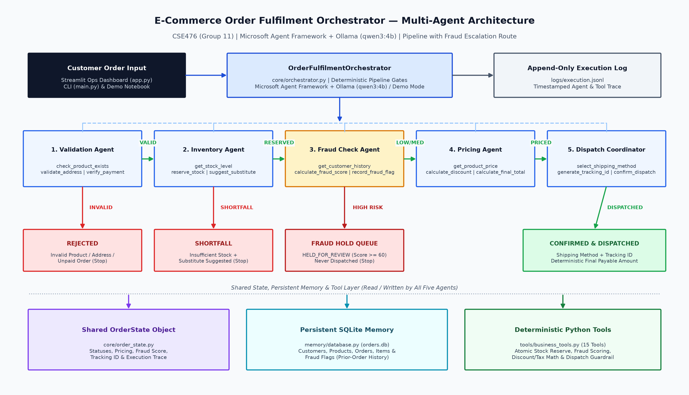

# E-Commerce Order Fulfilment Orchestrator

**Course:** CSE476 – Agentic AI and Intelligent Automation (CA2 – Task 2, Group 11 Individual Project)  
**Framework:** Microsoft Agent Framework (`agent-framework-ollama`) + Local Ollama (`qwen3:4b`)  
**Stack:** Python 3.14, SQLite, Streamlit, pytest, Jupyter Notebook

---

## 1. Project Overview & Problem Statement

Manual or monolithic e-commerce order processing fails easily when product validation, stock reservation, fraud screening, pricing, and shipping dispatch are tightly coupled or handled by a single prompt. **Problem:** An order must never be dispatched if payment is incomplete, inventory cannot be reserved without negative stock, or a customer's historical behaviour indicates high fraud risk.

## 2. Project Objectives

- Automate end-to-end order fulfilment using **five specialised agents** in separate modules built on **Microsoft Agent Framework**.
- Enforce deterministic business logic (atomic inventory reservation, transparent fraud scoring, exact pricing math, and dispatch guardrails) via **15 plain Python tool functions** (3 tools per agent).
- Persist customer order history and fraud flags in **SQLite** across restarts and record every step in an **append-only JSONL execution log**.

---

## 3. Five-Agent Roster & Python Tools

| Stage | Agent & Module | Responsibility | Registered Python Tools (`tools/business_tools.py`) |
|---:|---|---|---|
| 1 | **Validation Agent** (`agents/validation_agent.py`) | Verifies product ID, quantity, address, and payment status (`VALID`/`INVALID`). | `check_product_exists`, `validate_address`, `verify_payment` |
| 2 | **Inventory Agent** (`agents/inventory_agent.py`) | Checks stock, atomically reserves units, suggests substitutes (`RESERVED`/`SHORTFALL`). | `get_stock_level`, `reserve_stock`, `suggest_substitute` |
| 3 | **Fraud Check Agent** (`agents/fraud_agent.py`) | Queries SQLite customer history, computes risk score (0–100), records flags (`LOW`/`MEDIUM`/`HIGH`). | `get_customer_history`, `calculate_fraud_score`, `record_fraud_flag` |
| 4 | **Pricing Agent** (`agents/pricing_agent.py`) | Computes deterministic subtotal, 5% sample discount (≥ ₹3,000), 18% sample tax, and final total. | `get_product_price`, `calculate_discount`, `calculate_final_total` |
| 5 | **Dispatch Coordinator** (`agents/dispatch_agent.py`) | Re-verifies all upstream stages, picks shipping method, generates tracking ID, confirms dispatch. | `select_shipping_method`, `generate_tracking_id`, `confirm_dispatch` |

---

## 4. Architecture & Why It Fits



**Coordination Pattern — Sequential Pipeline with Fraud Escalation Route (`core/orchestrator.py`):**  
Order fulfilment has strict causal dependencies: stock must not be deducted before payment/address validation, fraud cannot be scored until the item is confirmed, and pricing/dispatch must never run for invalid, out-of-stock, or high-risk orders. The orchestrator enforces deterministic Python hard-stops after Stages 1, 2, and 3—routing high-risk orders (`score >= 60`) directly to the **Fraud Hold Queue (`HELD_FOR_REVIEW`)** while keeping reserved stock held pending manual review.

---

## 5. Shared State & Persistent Memory

- **Shared `OrderState` (`core/order_state.py`):** Passed across all five agents; tracks statuses, fraud score/reasons, deterministic totals, shipping/tracking details, and `execution_trace`.
- **SQLite Memory (`memory/database.py` → `memory/orders.db`):** Persists `customers`, `products`, `orders`, `order_items`, and `fraud_flags`. When a repeat customer orders again, `get_customer_history` retrieves prior failed payments (`+30`), prior fraud flags (`+30`), repeated cancellations (`+20`), high order value ≥ ₹5,000 (`+25`), and new-customer high value (`+15`) *(configurable demonstration rules, not production fraud detection)*.
- **Append-Only Audit Log (`logs/execution.jsonl`):** Every agent and tool action appends one immutable JSON line with timestamp, `order_id`, `agent_name`, `tool_used`, `result`, `explanation`, and `execution_mode`.

---

## 6. Handled Failure Scenario Example

**High Fraud Risk Escalation (`C104` – Vikram Mehta):** Seeded SQLite history records 3 prior failed payments (`+30`) and 1 prior fraud flag (`+30`). When `C104` submits a new `PAID` order, Stages 1–2 succeed, then Stage 3 (`Fraud Check Agent`) retrieves SQLite history, calculates score `>= 60` (`HIGH`), persists a new fraud flag, and triggers the orchestrator's escalation gate. Execution halts immediately with `decision = HELD_FOR_REVIEW`, `dispatch_status = HELD`, and `tracking_id = None`—and `confirm_dispatch` enforces an independent code-level guardrail that also blocks unsafe states.

---

## 7. Execution Modes (Local Ollama vs. Deterministic Demo Mode)

- **Live Ollama Mode (`EXECUTION_MODE=OLLAMA`):** Invokes real Microsoft Agent Framework `Agent` instances connected to local Ollama (`qwen3:4b` on `http://localhost:11434`, zero paid API keys).
- **Deterministic Demo Mode (`EXECUTION_MODE=DEMO`):** Executes the identical deterministic Python tools and pipeline guards without calling an LLM—selectable in the Streamlit sidebar or used automatically as a transparent fallback if Ollama is offline. Demo Mode explicitly tags logs as `DEMO` and never claims an LLM ran.

---

## 8. Setup, Run & Test Commands

```powershell
# 1. Activate the D-drive virtual environment
cd D:\AI\AgentProjects\Ecommerce_Order_Orchestrator
.\.venv\Scripts\Activate.ps1

# 2. (Optional) Ensure Ollama is serving qwen3:4b from D:\AI\OllamaModels
$env:OLLAMA_MODELS = "D:\AI\OllamaModels"
D:\AI\Ollama\ollama.exe list

# 3. Launch the Streamlit Operations Dashboard
streamlit run app.py

# 4. Run CLI demo (Live Ollama or Demo mode)
python main.py --mode OLLAMA
python main.py --mode DEMO

# 5. Run automated pytest suite (uses isolated temporary DB & log)
pytest tests/test_scenarios.py -v
```

*(Sample product catalog, 5% discount threshold, 18% tax rate, and fraud weights are configurable demonstration assumptions defined in `.env.example`.)*
